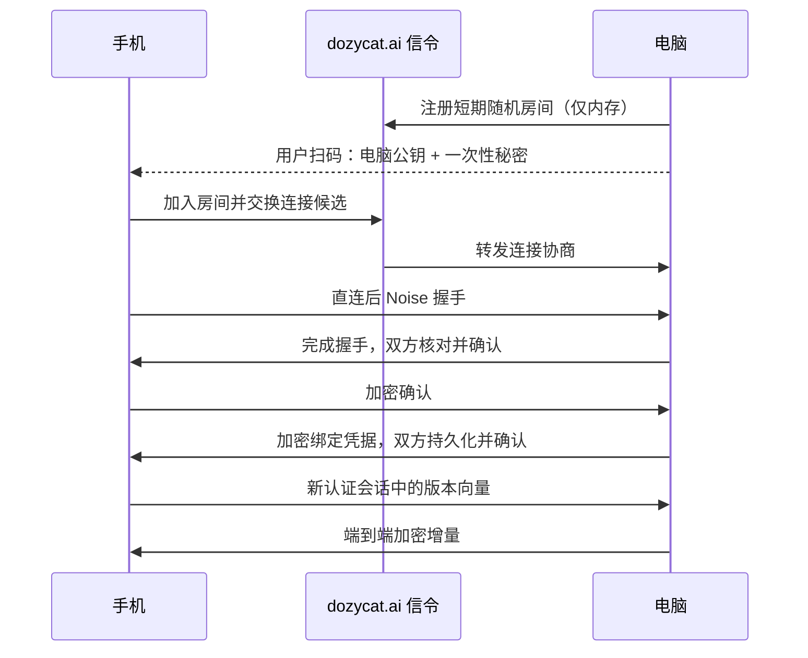

# 手机端与无账号设备绑定 · 设计提案

日期：2026-09-11。状态：手机本地功能已实现；信令服务和 Noise 内核已有代码与测试，产品端到端连接尚未完成，也未通过安全审计。
当前代码边界见 [实现进度](LINK-IMPLEMENTATION.md)，下文仍包含尚未落地的协议目标。
本提案替代 MEMORY-SYNC.md 中 CloudKit、云端密文信箱和基于账号认证的后续路线；
保留现有 Rust/Loro 数据模型与本地优先原则。新要求是 iOS + Android、无需登录、
dozycat.ai 不持久化用户内容，默认只做设备发现与连接协商。

### 手机端实现进度（2026-09-11）

`apps/mobile` 已从 starter 改为可运行的 Expo Go 应用：今日、小传、设置三个入口，以及能量自评、休息计时、睡前模式、JSON 小传导入导出和本地提醒。
当前移动端用 Expo SQLite 保存版本化本地文档，Web 预览使用独立浏览器存储；
Rust/Loro 与旧 SwiftUI 数据迁移尚未接入，不具有跨端合并能力。
倾诉、回顾及模型配置入口已撤下；既有本地数据仍保留。
iOS development build 已接入同 Wi-Fi 原生配对和 Noise 授权流程；Expo Go/Web/Android 仍不开放连接。
公网发现和业务数据自动同步尚未接入，不能作为完整端到端同步已完成的证据。
本地 SQLite 尚非应用级加密；Android 独立包禁用系统备份，iOS 数据目录备份排除
仍待原生实现，Expo Go 的宿主行为不能由 app.json 完全控制。
EAS project ID 已写入配置；账号权限仍待登录校验。当前验证为类型检查、自动化逻辑
测试、浏览器交互与三平台 JS/Hermes 导出，不替代真机签名构建或协议审查。

## 手机技术栈

采用 Expo SDK 57 + 配套 React Native 0.86 / React 19.2 + TypeScript +
New Architecture + Hermes。依赖以 Expo 稳定 SDK 的兼容矩阵为准，
精确补丁号与所有原生依赖在实施时核对、锁定。
RN 已经提供原生应用宿主，不需要再套 Capacitor、WebView 或 Electron。
“壳”只是一层 Swift / Kotlin 平台适配：系统权限、安全存储、健康数据、通知、
相机扫码、网络生命周期，以及 Rust 绑定。UI 和业务交互共用 TypeScript。

按用户确认选择 Expo，以其最新稳定兼容组合为升级单位，不单独追 RN 最新版本。
开发分两步：先用 Expo Go 预览页面、导航与交互；接入 Rust / 自定义网络模块时切到
development build（expo-dev-client），通过本地 Expo Module 封装 Swift/Kotlin
与 UniFFI。Expo Go 阶段不代表 Rust 同步或 E2EE 已经实现。
采用 prebuild / config plugins 管理原生工程配置，原生源码与构建脚本保存在独立模块，
避免重新生成 ios/android 时丢失手工修改。可本地构建，EAS Build 为可选工具；
Expo 不承担用户数据同步或身份认证，运行时无需依赖 Expo 云服务。
来源：[RN 版本](https://reactnative.dev/versions)、
[RN 发布说明](https://reactnative.dev/blog)、[Expo SDK 57](https://expo.dev/changelog/sdk-57)。

```text
apps/mobile/（Expo starter 已创建，原生内核接入待实现）
  Expo / React Native / TypeScript：今日、小传、设置（设备连接位于设置）
       ↓ typed local Expo Module
  iOS Swift adapter             Android Kotlin adapter
       ↓ UniFFI                       ↓ UniFFI
  dozycat-core：现有 Loro + SQLite，补充同步会话接口
  dozycat-link（拟新增 Rust crate）：配对、身份验证、加密、连接状态机
       ↓ 平台网络适配
  WebRTC reliable ordered DataChannel（连接协商与 NAT 穿透）

macOS：保留 AppKit + SwiftUI，接同一份 core / link
```

UniFFI 生成 Swift/Kotlin 接口，仍需手写 Expo Module 这一层；它不会自动生成 RN UI 绑定。
首个技术验证必须覆盖两个手机真机与 macOS，包括后台线程、取消、二进制拷贝、ABI。
密钥和加密实现留在 Rust/原生侧，JS 只获得业务数据与状态。
现有 core 已有 version/export_updates/import_updates；目前 SyncTransport 的 push/pull
是持久信箱抽象，需新增连接会话接口，不能直接把它当成已实现的 P2P 同步。
来源：[UniFFI](https://mozilla.github.io/uniffi-rs/latest/)。

## 产品交互

首次打开先完成通讯录与通话记录导入，在本机筛出最近一年联系过的人，直接进入花园。
不要求先登录、绑定电脑或配置模型；设置 → 我的设备 → 连接电脑。
沿用奶油纸感、珊瑚生理能量、蓝灰心理能量和几何猫的视觉语言。

| 界面/状态 | 交互与文案方向 |
| --- | --- |
| 手机未绑定 | “我先陪你待在这里。”主按钮“连接电脑”，可稍后再说 |
| 电脑添加设备 | 二维码 + 两分钟倒计时；关闭窗口立即作废 |
| 手机扫码后 | 展示电脑名称、将同步的类别；“这是我的电脑” |
| 电脑待确认 | 展示新设备名称和校验信息；“允许连接”/“拒绝” |
| 首次同步 | “正在把小传带过来”，明确进度，可继续使用本地功能 |
| 已连接 | 设备名称、最近同步时间、待同步状态、移除入口 |
| 对端不在线 | “电脑醒来后，我再把新小传带过去。” |
| 网络无法直连 | “这张网络暂时连不上电脑，试试同一个 Wi-Fi。” |

扫码权限在点击扫码时申请；健康数据另行解释与授权，不与绑定捆绑。
手机已经有小传时，首次同步明确说明双方会合并数据，不能静默覆盖。
设备名称只是展示文字，不能用于认证；设备名称由对端提供，不代表真实硬件归属。

## 首次见面：把最近联系的人带进花园

产品主路径：说明用途 → 授权通讯录 → 导入可用通话记录 → 本机匹配与筛选 →
直接进入花园。导入成功不再增加逐人确认、关系问卷或完成页；花园内轻提示
“我把最近一年联系过的 N 位朋友带进来了。”用户可以在花园里移除或修改人物卡。
主按钮“把最近联系的人带进来”，次入口“先进入花园”；跳过时进入空花园，之后可补导入。
通讯录与通话记录分别说明、分别授权，系统弹窗只在用户点击后触发。

筛选约定（首版）：

- 通讯录提供姓名和号码，通话记录提供联系时间；仅在通讯录出现不能证明最近联系过。
- 以本次导入开始时间为基准，使用本地日历向前减一年，保留时间落在闭区间
  `[一年前, 导入开始时间]` 的有效联系记录；不使用固定 365 天，排除未来或无法解析的时间。
- 首版自动联系证据为已接通的呼入/呼出通话，未接、拒接、骚扰记录不单独构成入园依据。
  微信等聊天联系未在本次数据源覆盖，不能据此宣称已找到所有最近联系的人。
- 号码按国家/地区规范化后精确匹配，一个联系人多个号码合并；同名不合并。
  共享号码、归属不明和未匹配号码不自动创建人物卡，留待用户补充确认。
- 只持久化入选人物的必要姓名、匹配标识、最近联系时间和证据来源；不保存整本通讯录
  或整份通话清单，不从通话次数推断亲密度。原始导入内容仅用于本机筛选。
- 导入按稳定联系人标识幂等合并，重试或重复导入不生成重复卡；保留既有人物卡的
  用户编辑与旧证据。“最近一年”是本次导入筛选规则，不自动删除已有花园人物，
  更不删除系统通讯录。失败或中断可重试，成功写入后才标记导入完成。

平台能力必须反映在实际流程中，不能展示无法兑现的授权按钮：

| 平台/状态 | 首次导入行为 |
| --- | --- |
| iOS 通讯录 | 使用系统 Contacts 授权；只处理获准的联系人，支持有限访问 |
| iOS 系统通话历史 | 首版不假定存在可读取全量系统历史的公开接口；采用用户主动导入的受支持记录文件，或手动确认最近一年联系过的人 |
| Android 通话历史 | 仅在发行渠道允许且获得权限时读取；Google Play 的通话记录权限受默认处理程序/例外规则限制，不能假定普通陪伴应用符合条件 |
| 有通讯录、无可用通话记录 | 明示“还无法判断最近联系过谁”，可导入记录或手动选择并确认近一年联系过的人，再直接入园；不自动全量导入 |
| 拒绝/受限/导入失败 | 提供重试与“先进入花园”；未获授权的数据不处理，不能把错误显示为零联系人 |
| 有效记录筛选后为零 | 进入空花园，提示“这份记录里还没有找到最近一年联系过的人”，提供补充入口 |

手动确认记录标记为用户确认，时间未知时不伪造最近通话日期。文件导入属于待实现的
平台降级方案，首版实施时固定格式与字段校验，并验证真实可获得的导出样本；
不在没有导出来源的情况下承诺一键完成。通讯录权限有限或通话历史不足一年时，
导入结果说明覆盖范围；缺失数据不代表没有联系。

花园人物首版保存在手机本机，与下文 people 不同步的范围一致。花园是手机端的新入口，
仍需实现人物存储与界面；现有小传/能量 CRDT 不等于已支持人物同步。

依据：[Apple 联系人有限访问](https://developer.apple.com/documentation/contacts/cnauthorizationstatus/limited)、
[Android 默认处理程序权限](https://developer.android.com/guide/topics/permissions/default-handlers)、
[Google Play 通话记录权限政策](https://support.google.com/googleplay/android-developer/answer/10208820)。

## 信任与密钥

无账号不等于无身份：每次安装生成独立 X25519 长期身份密钥，由操作系统 CSPRNG 取随机数。
公钥是密码学身份；可显示带协议域分隔的 SHA-256 公钥指纹。Loro PeerID 只标识副本，
不得当认证凭据。每对设备本地保存对端公钥、授权范围、绑定状态与发现秘密。
不建服务器 user_id、手机号、邮箱、密码或可恢复账号。

首版使用逐对授权：A-B 已绑定、B-C 已绑定，不代表 A-C 自动信任。
一台电脑与一台手机为首个交付范围；多电脑/多手机必须显式逐对绑定。
设备撤销信息不进普通可合并业务 CRDT，避免旧副本把权限合并回来。

iOS 身份密钥使用不经 iCloud 同步的 ThisDeviceOnly Keychain 存储策略；
Android 以 Keystore 中的不可导出包装密钥保护 Rust 使用的 X25519 密钥文件。
不得宣称所有设备都能把 X25519 私钥放入 Secure Enclave / StrongBox：Rust 执行握手时
可能需要将解封装后的身份密钥载入内存。锁屏可用性与后台同步依存关系在真机验证。
来源：[Android Keystore](https://developer.android.com/privacy-and-security/keystore)。

## 首次绑定算法

采用标准 Noise 模式的成熟实现，不自写椭圆曲线或 AEAD；以下为应用协议提案，
精确字节编码、消息上限、测试向量与实现库选型须在协议实现前固定。

1. 电脑进入添加设备，生成 128-bit 随机 room_id、256-bit 一次性 psk，TTL 120 秒。
   电脑保存 pending 记录；服务器仅获得 room_id 和临时连接路由，绝不获得 psk。
2. 电脑用专用扫码格式展示 `{version, room_id, desktop_public_key, psk, expires_at}`。
   服务地址由应用内置白名单决定，不能由二维码任意指定。二维码不经过网页、统计或日志。
   过期以电脑本地单调时钟为准；二维码的时间字段只是显示提示。
3. 手机在本地解析二维码，钉住电脑公钥；通过 WSS 信令交换 ICE 信息，尝试建立直连。
   信令和 room_id 不提供身份认证；被恶意修改最多应导致连接失败，不能获得业务数据。
4. 手机作为 initiator、电脑作为 responder，在 DataChannel 上执行
   `Noise_IKpsk2_25519_ChaChaPoly_SHA256`：电脑公钥来自二维码，psk 来自扫码，
   手机静态公钥在握手中交给电脑。prologue 绑定应用协议版本、room_id 与角色。
   握手期间不允许传小传、授权操作或其他业务数据。
5. 双方完成握手后仍为 pending。两端展示与握手 transcript 绑定的校验指纹，
   用户比对后在手机确认电脑、在电脑批准手机；允许按钮绑定该会话与手机公钥。
   指纹呈现编码在实现时固定；不能用简单六位 PIN 替代二维码的 256-bit 秘密。
6. 双方加密交换确认。电脑生成新的随机 pair_secret，经已认证通道交给手机；
   双方持久化 pair_id、对端公钥和同步 scope，使用幂等确认消息完成绑定。
   只有进入 active 后才开放数据接口；断线中间态只允许恢复确认，不能自动扩权。
7. 电脑原子消费邀请并销毁 psk、关闭 room；同一邀请只能激活一个手机。
   并发候选不得覆盖正在确认的公钥。拒绝、超时、关闭窗口都会销毁邀请。

二维码是一次性邀请凭据。截图外泄可能让别人参与配对，因此需要短 TTL、单次使用、
会话绑定的双方确认与指纹核对；服务器抢先占用 room 只能造成拒绝服务。
服务端临时限流不能替代电脑本地的邀请状态和授权判断。
Noise 模式定义参考：[Noise 规范](https://noiseprotocol.org/noise.html)。



## 后续发现与认证

重连时默认由手机发起，全新执行 `Noise_IK_25519_ChaChaPoly_SHA256`，
双方从本地 active ACL 钉住对端公钥，并证明各自持有私钥。
每次握手使用新 ephemeral key，握手完成前没有业务数据或 0-RTT 写入。
静态身份密钥与临时会话密钥分离，不能把首次扫码密钥永久当数据加密密钥。

pair_secret 只用于发现/信令，通过 HKDF-SHA256 派生不同用途的子密钥。
提议以 `HMAC(K_discovery, protocol || time_bucket)` 生成每五分钟轮换的发现房间，
容忍相邻时间桶与有限时钟偏差；公网发现不公开固定设备指纹。
具体编码须无歧义、域分隔。已绑定信令用独立 K_signal 做带随机 nonce 的 AEAD，
附消息 ID、有效期与本地去重缓存；房间名并不赋予同步权限。
服务器重启后客户端退避重注册，不恢复设备目录。大幅时钟错误需提示校时/局域网重连。
局域网发现只广播短期随机标识，仍执行同样的公钥认证。

## 网络与“服务器不存储”的精确含义

默认严格模式：同局域网直连或 ICE/STUN 打洞。dozycat.ai 只转发短期信令，
没有用户数据库、离线邮箱、对象存储，也没有后台待投递的业务密文。
信令路由、必要消息缓冲与限流状态只放有上限、短 TTL 的内存中。
服务运维须禁用含 IP/房间/请求体的持久访问日志、APM payload、swap 与 core dump，
同时检查 CDN/代理日志设置；允许无设备标识的聚合运行指标。

某些 NAT、防火墙或企业网络无法直连。WebRTC 官方明确这类连接可能需要 TURN。
可另设用户显式开启的“允许临时密文中继”：中继只转发当前在线会话密文，不落盘、不排队，
业务层 Noise 加密不变。但这超出了“只负责握手”，不能在严格模式下偷偷自动降级。
来源：[WebRTC TURN](https://webrtc.org/getting-started/turn-server)。

服务器运行时仍会见到 IP、时间、流量和临时房间关系；不持久化不等于看不到元数据，
也不防恶意服务器拒绝服务。用户内容始终不作为信令载荷发送。
无云端队列时，两端须同时在线且获得运行时间才能同步；电脑睡眠不会收到新小传。
iOS 后台调度由系统决定，不能保证实时常驻 P2P。首版以前台自动同步为主，后台尽力；
本地休息/喝水通知不依赖电脑。APNs/FCM 唤醒不是首版必要依赖，也不保证唤醒。
来源：[Apple 后台策略](https://developer.apple.com/documentation/backgroundtasks/choosing-background-strategies-for-your-app)。

## 数据同步与能力边界

首版 scope = 小传 + 能量账本。raw、notes、people、links、cases、journal 保持本机，
不因绑定而开启远程文件访问、shell 或桌面代理控制。聊天、健康数据、附件另定授权范围。
现有 iOS SettingsStore 使用可同步 iCloud Keychain 保存 BYOK；新身份密钥绝不能复用
该策略。API Key 默认各设备配置，迁移时明确提示，不能悄悄跨端传送。

同步流程：认证 → 校验本地 ACL / scope / 协议版本 → 加密交换版本向量 →
导出差量 → 有界分块 → 加密传输 → 校验、导入并持久化 → ACK → 更新对端进度。
ACK 丢失可重发；重连重新交换实际持久化版本，不能信任上次“已发送”的游标。
新设备随机生成自己的 Loro PeerID，不能复制电脑数据库中的副本身份。

业务帧包含 workspace_id、scope、message_type、transfer_id、chunk_index、长度；
这些字段全部在已认证加密通道内。Noise 会话按方向独立维护 nonce 序列，
进程恢复不复用旧密钥/nonce；可靠有序传输中认证失败即关闭连接。
限制总传输量、分块大小、未完成传输数、解压比例与 CRDT 导入资源使用。
CRDT 的幂等合并只解决重复更新，不提供身份认证、授权或完整的重放防护。
首轮差量过大或历史压缩不兼容时，走显式快照恢复；不能拿不兼容旧增量盲目合并。

E2EE 不会自动加密本地 SQLite。现有 core 依赖 bundled SQLite，不能标为已实现
数据库加密；本地加密、WAL/临时文件、操作系统备份排除需单独实现与验证。
首版多端同步数据排除自动云备份，以免把“只存设备”变成隐含云存储。
模型调用也独立于同步：现有 BYOK 可能把上下文交给用户选择的模型服务，
不能把 dozycat.ai 不存储宣传成“任何数据都不离开设备”。

## 解绑、丢失与恢复

本机点击移除设备：立即将该 peer 标为 revoked、断开会话、删除 pair_secret、
停止发现，并在每次新连接及数据导入前检查撤销状态。离线对端上线也不能再被本机接受。
逐对信任意味着须在其他仍信任失窃设备的端上分别撤销；首版不宣称全网即时撤销。
绑定设备可能已经复制明文，解绑不能远程抹除它已取得的内容。

剩一台设备就可以重新扫码绑定新设备，恢复它现有的内容；不迁移已丢失设备身份。
全部设备丢失且没有用户自行保存的数据备份，无法恢复；一张恢复码本身没有数据。
备份可后续做用户主动导出的加密文件，恢复密钥由用户保管，不上传 dozycat.ai。
系统恢复/重装需检测数据库与密钥不匹配，重新生成副本身份并重新绑定。
CRDT 删除和压缩也不能保证抹掉旧设备、备份或已导出的副本，不承诺远程物理真删。

## 实施顺序与验收

1. 建 apps/mobile Expo 工程与 development build，iOS/Android 真机跑通今日、小传与 Rust 读写；
   保留 apps/ios 作为迁移参照，验证无损导入并生成新副本身份。
2. 做 dozycat-link 的本地双端协议验证：扫码、双向确认、身份钉住、撤销、密钥持久化；
   使用成熟 Noise 实现和标准测试向量，固定应用帧与状态机后再接真实数据。
3. 接 macOS 与手机局域网 E2EE 增量，验证断线、ACK 丢失、并发修改与进程崩溃恢复。
4. 部署内存信令与 STUN，验证手机蜂窝网络、不同 Wi-Fi、严格防火墙的成功/失败 UI；
   密文中继作为独立后续决策，默认不启用。
5. 上线前做协议审查及真机隐私验收：伪造/替换服务端信令、公钥错配、二维码过期复用、
   并发配对、握手重放、未批准发数据、撤销后重连、跨 workspace 导入、畸形大帧、
   nonce 生命周期、手机锁屏、双端离线、服务器重启、备份和日志不泄漏。

信令与 Noise 内核已进入实现，详见 LINK-IMPLEMENTATION.md；完整原生兼容矩阵、WebRTC 库与性能，
需要第一阶段真机验证。协议评审通过之前，不将方案描述为经过审计或已上线的 E2EE。
